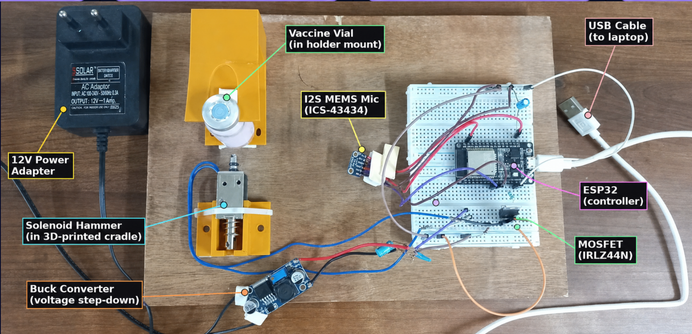
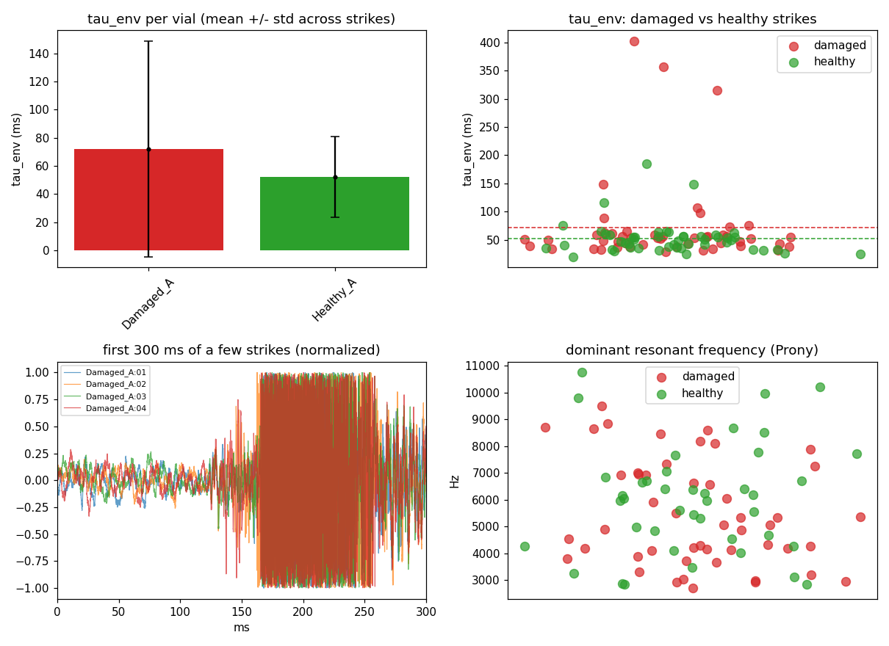

# VaxCheck — Acoustic Vaccine Vial Integrity Verification

> Non-destructive, one-second freeze damage verification for sealed vaccine vials using solenoid acoustic excitation, MEMS I2S sensing, and machine learning.



---

## Why it matters
Freeze damage in aluminum-adjuvanted vaccines (DTP, Hepatitis B, pentavalent) is
permanent and invisible — a thawed vial looks completely normal. Studies found
14–35% of cold-chain refrigerators/shipments exposed vaccines to freezing; the
only field check, the WHO Shake Test, takes 15–30 minutes, destroys a control
vial, and is judged by eye. VaxCheck reads the same physics — aggregation
changes how the vial's ring decays — in one second: healthy vials ring at
τ ≈ 40 ms, freeze-damaged at τ ≈ 12 ms (pilot data, Cohen's d ≈ 16).

## Status — honest
Engineering prototype with pilot data. Physics separation is large; classifier
accuracy is data-volume-limited (reported with stratified 5-fold CV). Next:
blinded field validation against the WHO Shake Test. Screening tool, not a
diagnostic. Built for ForgeHacks 2026 (AI + Healthcare).

Demo video: [FILL — YouTube URL]

---

## System Architecture

```text
[ Physical Vial ]
       │
       ▼  (Solenoid Strike + ICS-43434 I2S Microphone)
[ ESP32 Unit ] (Firmware: 32 kHz, 800 ms binary frame @ 921,600 baud)
       │
       ▼  USB Serial (Binary Frame: Magic 0x56 0x58)
[ Python Sidecar Service ] (Flask @ Port 5001)
       │  • Frame Sync & 16-bit WAV writing
       │  • Feature Extraction (analyze_strikes.py)
       │  • SVM Classifier Pipeline (vaxcheck_svm_best_practice.joblib)
       │  • Quality Gates Evaluation
       ▼
[ Node.js Backend Server ] (Express @ Port 5000)
       │  • RESTful API (/api/v1/hardware, /api/v1/tests, etc.)
       │  • MongoDB Atlas Integration & Audit Trail
       │  • Batch Failure & Quarantine Alerts
       ▼
[ React 19 Web Client ] (Vite @ Port 3000)
          • Real-time Test Triggering & Hardware Telemetry
          • Healthy / Damaged / Retest Needed Classification Cards
          • Acoustic Resonance Breakdown & Audio Replay
          • Clinic Worker & Admin Inspection Dashboard
```

---

## Key Features

1. **Non-Destructive Testing**: Test sealed vials without opening or contaminating the vaccine.
2. **Real Hardware Integration**:
   - ESP32 drives IRLZ44N MOSFET gate for calibrated solenoid impact.
   - High-fidelity ICS-43434 MEMS digital I2S microphone captures 32 kHz acoustic ring-down.
3. **Machine Learning Pipeline**:
   - 10 extracted acoustic features: `onset_ms`, `snr_db`, `tau_env_ms`, `tau_env_r2`, `prony_freq_hz`, `prony_tau_ms`, `prony_r`, `band_mid_pct`, `band_high_pct`, `ring_energy`.
   - Pipeline: `SimpleImputer` → `StandardScaler` → `SelectKBest(k=9)` → `SVC(rbf, probability=True)`.
4. **Strict Quality Gates**:
   - Audio silence / zero check
   - SNR >= 10 dB
   - Peak amplitude between 15% and 95% full scale
   - Finite exponential decay constant (tau)
   - Model confidence >= 0.60
5. **Multi-Strike Protocol**: standardized strikes with ≥10 s settling time between them, majority voting across strikes.
6. **Digital Health Cloud**: Automatic sync with MongoDB Atlas, complete test history, and batch-level freeze warnings.

---

## Acoustic Resonance Diagnostics



---

## Repository Structure

```text
VaxcheckSoftware/
├── README.md                    # Project documentation
├── LICENSE                      # MIT License
├── start_vaxcheck.bat           # 1-click launcher for all 3 web services
├── analyze_strikes.py           # Feature extraction engine (Hilbert, Prony, FFT)
├── capture_strikes.py           # Standalone serial recorder CLI
├── hackathon_demo.py            # Diagnostic demo script
├── silent_test.py               # Solenoid-off noise floor calibration
├── docs/
│   └── screenshots/             # Hardware and UI captures
├── firmware/
│   └── VaxCheck_capture.ino     # Direct-drive ESP32 firmware (921,600 baud)
├── data/                        # Training audio datasets (Healthy & Damaged)
├── model/                       # Jupyter notebooks and model development
├── results/                     # Extracted CSV features and trained joblib models
└── website/
    └── VaxCheck/
        ├── client/              # React 19 + Vite web interface
        └── server/              # Node.js Express backend + Python sidecar
            ├── src/             # Express routes, controllers, and models
            └── python_sidecar/  # Flask service (vaxcheck_service.py)
```

---

## Quick Start

### 1. Prerequisites
- **Node.js** (v18+)
- **Python** (3.10+) with `pyserial`, `flask`, `flask-cors`, `numpy`, `scipy`, `scikit-learn`, `joblib`
- **ESP32** flashed with `firmware/VaxCheck_capture.ino` (COM port on Windows or `/dev/ttyUSB0` on Linux)

### 2. Environment Setup
Create `website/VaxCheck/server/.env` based on `website/VaxCheck/server/.env.example`:
```env
MONGODB_URI=your_mongodb_connection_string
PORT=5000
CORS_ORIGIN=http://localhost:3000
JWT_SECRET=your_jwt_secret
CLIENT_URL=http://localhost:3000
```

### 3. Install Dependencies
```bash
# Python Sidecar
cd website/VaxCheck/server/python_sidecar
pip install -r requirements.txt

# Node.js Server
cd ../
npm install

# React Frontend
cd ../client
npm install
```

### 4. Run the Application
You can launch all services at once on Windows using:
```bash
start_vaxcheck.bat
```

Or run them in separate terminals:
- **Terminal 1 (Python Hardware Sidecar)**:
  ```bash
  cd website/VaxCheck/server
  python python_sidecar/vaxcheck_service.py
  ```
- **Terminal 2 (Node.js Backend)**:
  ```bash
  cd website/VaxCheck/server
  npm start
  ```
- **Terminal 3 (React Frontend)**:
  ```bash
  cd website/VaxCheck/client
  npm run dev
  ```

Open [http://localhost:3000](http://localhost:3000) in your browser.
